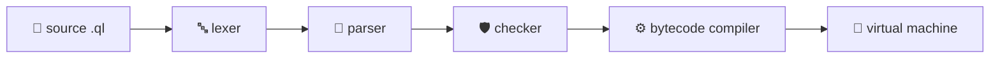
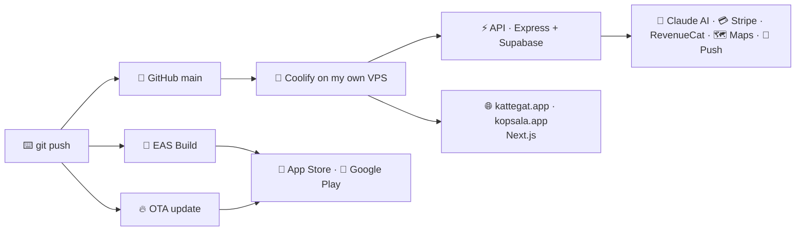

<div align="center">


<br/>


</div>


### 💀 `whoami`

 <sub>Written in <a href="https://github.com/Ngwangshalom/Quill">Quill</a>, my own programming language. It really runs.</sub>

```lua
-- ngwang.ql · my profile, compiled.

me = record name = "Ngwang Shalom", role = "CTO // Lead Engineer", city = "Dubai"
shipped = list "Kattegat", "Kopsala", "Quill"
var bugs = 0

fn ship(project: text) -> text
  fails WorksOnMyMachine
  when
    project == "" -> fail WorksOnMyMachine
    else -> return "{project} · live in production"

fn report(project: text) -> text
  var status = ship(project)
    on WorksOnMyMachine -> return "{project} · never happens"
  return status

fn excuse_for(deadline: text) -> maybe text
  when
    deadline == "never" -> return found "maybe tomorrow"
    else -> return missing

say "{me.name}  ·  {me.role}  ·  {me.city}"
for project in shipped
  say "  ✓ {report(project)}"

when excuse_for("tonight")
  found reason -> say reason
  missing -> say "  excuses: 0 found"

say "  bugs: {bugs}"
check bugs == 0     -- this line is a test. it passes.
```

```console
$ quill run ngwang.ql
Ngwang Shalom  ·  CTO // Lead Engineer  ·  Dubai
  ✓ Kattegat · live in production
  ✓ Kopsala · live in production
  ✓ Quill · live in production
  excuses: 0 found
  bugs: 0
```

<div align="center">

</div>


###  I WROTE MY OWN PROGRAMMING LANGUAGE

<div align="center">

<a href="https://github.com/Ngwangshalom/Quill"></a>

## [Quill](https://github.com/Ngwangshalom/Quill)

**Write what you mean.** Intent is clear, failures are explicit, and correctness is part of the code.


[](https://github.com/Ngwangshalom/Quill/releases)
[](https://github.com/Ngwangshalom/Quill/actions)
[](https://github.com/Ngwangshalom/Quill)
[](https://github.com/Ngwangshalom/Quill/stargazers)

</div>

```lua
-- Money is exact. Failures are named. Nothing is null.
fn charge(amount: USD) -> text
  fails Declined
  when
    amount <= 0 USD -> fail Declined
    else -> return "paid"

fn fee_for(act: text) -> maybe USD
  when
    act == "Bamenda Brass" -> return found 150000 USD
    else -> return missing

fn book(fee: USD) -> text
  var receipt = charge(fee)
    on Declined -> return "card declined"
  return "{receipt}: {fee}"

when fee_for("Bamenda Brass")
  found fee -> say book(fee)
  missing -> say "not on the roster"

check 100 USD + 50 USD == 150 USD     -- tests live in the code
```

```console
$ quill run booking.ql
paid: 150000 USD
```



<div align="center">

| Ships with | |
|---|---|
| 🧪 `quill test` | every `check` line and doc example runs as a test |
| 🔍 `quill explain` | shows exactly how the compiler read a line |
| 🩺 `quill lsp` | red underlines in any editor, plus a VS Code / Cursor extension |
| 🔁 `quill update` | pick a version with the arrow keys |
| 📖 The Quill Book | teaches the language from zero, every example tested |

```bash
curl --proto '=https' --tlsv1.2 -LsSf https://github.com/Ngwangshalom/Quill/releases/latest/download/quill-installer.sh | sh
```

<sub><i>Most developers argue about languages. I shipped one.</i></sub>

</div>


### 🟢 LIVE IN PRODUCTION. RIGHT NOW.

<div align="center">

[](https://kattegat.app)
[](https://kopsala.app)
[](https://kattegat.app)

</div>



<sub><i>No DevOps team. No agency. No "handover". Code to store to server, owned end to end.</i></sub>


### ⚔️ THE ARSENAL

<div align="center">

**🧬 LANGUAGES**<br/>

<a href="https://github.com/Ngwangshalom/Quill"></a>

**🎨 FRONTEND & MOBILE**<br/>


**⚙️ BACKEND & DATA**<br/>


**🛰️ INFRA & TOOLING**<br/>


<br/>

[-0D0D0D?style=flat-square&logo=data:image/png;base64,iVBORw0KGgoAAAANSUhEUgAAACAAAAAgCAYAAABzenr0AAAGfklEQVR4nL2XfXBU1RnGn/ece+9+JJsYNKkGiRg1JaEgFfoxnRHCR1sirUJnNhYcpWJnQ1sanSGo06mzC2NnLCCKOgVCDDK2BTZt7bRWLM2YaynTaUU6UENLRpDUmsAEs2k2m03uvee8/SMJ5mPzIYw+M3dm95573+c5v/ecM7vAp6FoVABMn4rXGONwXE70SMZUzEzjjU2mhoYGSiSKRVtbkjdvXuwBwILKus8RaeetQ5EWMBOIeOh5Y4JgEwXg0eO2bdNvTqXlc9VhVxC5goB5q/Z8IdGTjlzo6KqcXpD7ZQBALEaD7182GludWYwaG244wrz27bdF2+/P0ZYtlQ4YqN/X5H8q/s6KVNqJKKWWwcgWQif/3v7nx76kmQn4aPYTERgtGv3Ztm060BKivVULXALwlfv3F7Vf7Fr94/0nHlAsy8AE1p4r2NV+yzisGcCimMSb8KYSYAxiDMNm2xBLlyz2mIE77tkz51JP+ofnWjsqmYxcZgGJ/k4ppdev5HXQjgjlBI8AAApO86iaExIYHYI+6nOFe+cD+64//8H/Ym2J5INMpsXKBQTBknzGNI3Onl7vi0RCEKvWhzfcdeI7v2IiIjXVAMMXIQOADQgAeOHhu/pVZzz7bOulNzwESlmlAbh9ZAT9lvBsv0UtXT16HTEzGRZbhtf00OKb+/4a2WMCcD8OgREz7+jo4HA4rD9b8fx3T76besfzdCnrpAJBk5ntt4QTzw7Iox92qx1EWgJQREwBn3F4DPdhElMLAHz73kp109Idv+ju6X0ymUzPZJLMYI+MLNMSTv1nrgvUd3arbWBlgpkZIKi+nqIbpx0lApYty9OZik+0CNEAUGNVLb1Yt969sfzplxztX03c/a+0436embUws3w+w62bNT307KnzyWPM2g9WigEtzJBpoPetxr33t+/afdwMh+eP6f+EBGzbFs0xm+r2VrkzyrfVO9pYq52kJkE5nufOEUaW9JuqfvXKmx8/9V7365o5F+w6EKaURsA0yTlcMM3//QOHrvAorqqtNerWV7lFS7Zv7/OsjdrtcUHClIK7hBAhIvnK+00bKwsXbj+hmeZBO0xWiAQ7Z3N88pGWI4+8CgKU5qEATERj2pCRQCxmy71VVW7pN3cu7veMjdpJeURkQmuPKXCNFNR48WhNeMbi7b/VZM4DEUgYqaBPPRZdc9tcf1bg4tciB245eCgubXvkbppSgNOnOwQA9PWrMoCYCGDWigy/YZB7rM1+dHnhwq07Pcq6G6rP9Zt4eUZBzgqf4NYtB99rSiSTTxcb8mJzfj4B9oS0My/CssHImgtBRAxWJHw+U3r/fr9p06Jbv4oNKdeqNqn3ZFZu1h88j+m/l5L7WASKhe7tnXVb7q27flbZs/v242Z5ZL4eNM9IIGOAvPYEEwDX00WsPYCkaQi+VJqXvai04pmlac943jLUeWI4Xd3pH0D6clkzBKfVtXn+e47UVrU/u/M1XyQy3x1mPvUAZ24oGcCuuVBraCmEzrtGVnSyG+ru1a8opbT2uEhDziTWYC+VlkYwEPR50ebfVTdu2Pmar7q6Ysh8SBkpZFwDdqxceZqlZi6Qpk+E/GL9SysWnrzQ6TR6GkFmrVkzQ7sus2ZhhgKG6P/1+caanzwRjVvfmluhMMUfNJkIkCDimp/+JchMJQYnXz/3p8dfXOlsa/S0mAnd75AwLBImiCBJuymD+u2VC+esu/N7cZlIFHN5eUbcU90FUWIAb/ytebog1utWzb13+pKtWz0KLgUxpOm3JPEFS+pDIR/WzpoxbXabXfON52IVyfz8fIpEMp944xEZezMcl2ioVCXLtz3kKOMGE/rdlM4+wE7XWcsyGwOW+eodt087dvCp+xI8WGH37uNmScn88WZ+mUCmg2hsC8qamRlUtDzHuOXaRPeZD+iFgL//wVV3z2t4ZtPXUwyg5Y+EJ6JxC7PLUJjo48jAVrsijSYwcOaAA1tqNvyo/cP0ffFzyyoTb645rphFrKHZAIDy/Nl6stlmqJ2RwAjFw2EJAPuf3LTgP7vK0js2htcCQDS6J9jU1GQws8xwiUm+X74/KQ5uGmhJ38+LH+VfXs/cuiYPURbM45p/nCtjgMyptHC1Ii/1T9eHzULDticNf6XKHIA4KLLIyJIeDbSyHBhnH1+tRu6CjkETEfgHHH4ZofxegIHyjiHzqwnxiUzgkxFHITg65X9NV6X/AxN4bZ/xuzjNAAAAAElFTkSuQmCC)](https://github.com/Ngwangshalom/Quill)


<sub>Frameworks don't scare me. I scare frameworks.</sub>

</div>


### 🚀 BODY COUNT

| | Project | Damage Report | Built With |
|:-:|---|---|---|
|  | **[Quill](https://github.com/Ngwangshalom/Quill)** | My own programming language. Exact money, no null, declared failures, tests inside the code, errors that teach. Lexer to VM, written from scratch, with an LSP, an editor extension and a book. **Released.** | ![](https://img.shields.io/badge/-Quill-0D0D0D?logo=data:image/png;base64,iVBORw0KGgoAAAANSUhEUgAAACAAAAAgCAYAAABzenr0AAAGfklEQVR4nL2XfXBU1RnGn/ece+9+JJsYNKkGiRg1JaEgFfoxnRHCR1sirUJnNhYcpWJnQ1sanSGo06mzC2NnLCCKOgVCDDK2BTZt7bRWLM2YaynTaUU6UENLRpDUmsAEs2k2m03uvee8/SMJ5mPzIYw+M3dm95573+c5v/ecM7vAp6FoVABMn4rXGONwXE70SMZUzEzjjU2mhoYGSiSKRVtbkjdvXuwBwILKus8RaeetQ5EWMBOIeOh5Y4JgEwXg0eO2bdNvTqXlc9VhVxC5goB5q/Z8IdGTjlzo6KqcXpD7ZQBALEaD7182GludWYwaG244wrz27bdF2+/P0ZYtlQ4YqN/X5H8q/s6KVNqJKKWWwcgWQif/3v7nx76kmQn4aPYTERgtGv3Ztm060BKivVULXALwlfv3F7Vf7Fr94/0nHlAsy8AE1p4r2NV+yzisGcCimMSb8KYSYAxiDMNm2xBLlyz2mIE77tkz51JP+ofnWjsqmYxcZgGJ/k4ppdev5HXQjgjlBI8AAApO86iaExIYHYI+6nOFe+cD+64//8H/Ym2J5INMpsXKBQTBknzGNI3Onl7vi0RCEKvWhzfcdeI7v2IiIjXVAMMXIQOADQgAeOHhu/pVZzz7bOulNzwESlmlAbh9ZAT9lvBsv0UtXT16HTEzGRZbhtf00OKb+/4a2WMCcD8OgREz7+jo4HA4rD9b8fx3T76besfzdCnrpAJBk5ntt4QTzw7Iox92qx1EWgJQREwBn3F4DPdhElMLAHz73kp109Idv+ju6X0ymUzPZJLMYI+MLNMSTv1nrgvUd3arbWBlgpkZIKi+nqIbpx0lApYty9OZik+0CNEAUGNVLb1Yt969sfzplxztX03c/a+0436embUws3w+w62bNT307KnzyWPM2g9WigEtzJBpoPetxr33t+/afdwMh+eP6f+EBGzbFs0xm+r2VrkzyrfVO9pYq52kJkE5nufOEUaW9JuqfvXKmx8/9V7365o5F+w6EKaURsA0yTlcMM3//QOHrvAorqqtNerWV7lFS7Zv7/OsjdrtcUHClIK7hBAhIvnK+00bKwsXbj+hmeZBO0xWiAQ7Z3N88pGWI4+8CgKU5qEATERj2pCRQCxmy71VVW7pN3cu7veMjdpJeURkQmuPKXCNFNR48WhNeMbi7b/VZM4DEUgYqaBPPRZdc9tcf1bg4tciB245eCgubXvkbppSgNOnOwQA9PWrMoCYCGDWigy/YZB7rM1+dHnhwq07Pcq6G6rP9Zt4eUZBzgqf4NYtB99rSiSTTxcb8mJzfj4B9oS0My/CssHImgtBRAxWJHw+U3r/fr9p06Jbv4oNKdeqNqn3ZFZu1h88j+m/l5L7WASKhe7tnXVb7q27flbZs/v242Z5ZL4eNM9IIGOAvPYEEwDX00WsPYCkaQi+VJqXvai04pmlac943jLUeWI4Xd3pH0D6clkzBKfVtXn+e47UVrU/u/M1XyQy3x1mPvUAZ24oGcCuuVBraCmEzrtGVnSyG+ru1a8opbT2uEhDziTWYC+VlkYwEPR50ebfVTdu2Pmar7q6Ysh8SBkpZFwDdqxceZqlZi6Qpk+E/GL9SysWnrzQ6TR6GkFmrVkzQ7sus2ZhhgKG6P/1+caanzwRjVvfmluhMMUfNJkIkCDimp/+JchMJQYnXz/3p8dfXOlsa/S0mAnd75AwLBImiCBJuymD+u2VC+esu/N7cZlIFHN5eUbcU90FUWIAb/ytebog1utWzb13+pKtWz0KLgUxpOm3JPEFS+pDIR/WzpoxbXabXfON52IVyfz8fIpEMp944xEZezMcl2ioVCXLtz3kKOMGE/rdlM4+wE7XWcsyGwOW+eodt087dvCp+xI8WGH37uNmScn88WZ+mUCmg2hsC8qamRlUtDzHuOXaRPeZD+iFgL//wVV3z2t4ZtPXUwyg5Y+EJ6JxC7PLUJjo48jAVrsijSYwcOaAA1tqNvyo/cP0ffFzyyoTb645rphFrKHZAIDy/Nl6stlmqJ2RwAjFw2EJAPuf3LTgP7vK0js2htcCQDS6J9jU1GQws8xwiUm+X74/KQ5uGmhJ38+LH+VfXs/cuiYPURbM45p/nCtjgMyptHC1Ii/1T9eHzULDticNf6XKHIA4KLLIyJIeDbSyHBhnH1+tRu6CjkETEfgHHH4ZofxegIHyjiHzqwnxiUzgkxFHITg65X9NV6X/AxN4bZ/xuzjNAAAAAElFTkSuQmCC)    |
| 🎭 | **[Kattegat](https://kattegat.app)** | Dubai's hospitality and entertainment marketplace. Venues and planners on one side, entertainers and staff on the other. Chat, bookings, payments, an AI concierge. iOS, Android, web and infra, self-deployed end to end. **Live.** |    |
| 🕶️ | **[Kopsala](https://kopsala.app)** | Who's playing tonight in Dubai. Live acts on a map, tonight-only deals, tables in two taps. Second app, same backend, built in silence. **You're about to hear about it.** |    |
| ⚡ | **PulseStream** | Real-time updates so light your polling loop is embarrassed. |  |
| 🤖 | **WandaBot** | WhatsApp automation. It works while you sleep. I don't sleep either. |  |
| 💸 | **MTN Mobile Money API** | Payments integration. Money moves. Code doesn't flinch. |  |
| 🧠 | **MrNgwang AI Robot** | Conversational AI. Smarter than your last PR. |  |


### 📜 RULES OF ENGAGEMENT

```diff
+ Ship first. Debate never.
+ Own everything: UI, API, DB, servers, DNS, the App Store review. No hand-holding.
+ Done twice? Automated forever.
+ Tests pass before the coffee does.
+ Production is the only demo that counts.
- "It's on the roadmap."
- "Let's circle back."
- "Works on my machine."
- "We need another sprint."
- Asking permission to be great.
```


### 📊 THE RECEIPTS

<div align="center">


### 🐍 WATCH IT EAT MY CONTRIBUTIONS


</div>


<div align="center">

[](https://kattegat.app)
[](https://kopsala.app)
[![Quill](https://img.shields.io/badge/Quill-0D0D0D?style=for-the-badge&logo=data:image/png;base64,iVBORw0KGgoAAAANSUhEUgAAACAAAAAgCAYAAABzenr0AAAGfklEQVR4nL2XfXBU1RnGn/ece+9+JJsYNKkGiRg1JaEgFfoxnRHCR1sirUJnNhYcpWJnQ1sanSGo06mzC2NnLCCKOgVCDDK2BTZt7bRWLM2YaynTaUU6UENLRpDUmsAEs2k2m03uvee8/SMJ5mPzIYw+M3dm95573+c5v/ecM7vAp6FoVABMn4rXGONwXE70SMZUzEzjjU2mhoYGSiSKRVtbkjdvXuwBwILKus8RaeetQ5EWMBOIeOh5Y4JgEwXg0eO2bdNvTqXlc9VhVxC5goB5q/Z8IdGTjlzo6KqcXpD7ZQBALEaD7182GludWYwaG244wrz27bdF2+/P0ZYtlQ4YqN/X5H8q/s6KVNqJKKWWwcgWQif/3v7nx76kmQn4aPYTERgtGv3Ztm060BKivVULXALwlfv3F7Vf7Fr94/0nHlAsy8AE1p4r2NV+yzisGcCimMSb8KYSYAxiDMNm2xBLlyz2mIE77tkz51JP+ofnWjsqmYxcZgGJ/k4ppdev5HXQjgjlBI8AAApO86iaExIYHYI+6nOFe+cD+64//8H/Ym2J5INMpsXKBQTBknzGNI3Onl7vi0RCEKvWhzfcdeI7v2IiIjXVAMMXIQOADQgAeOHhu/pVZzz7bOulNzwESlmlAbh9ZAT9lvBsv0UtXT16HTEzGRZbhtf00OKb+/4a2WMCcD8OgREz7+jo4HA4rD9b8fx3T76besfzdCnrpAJBk5ntt4QTzw7Iox92qx1EWgJQREwBn3F4DPdhElMLAHz73kp109Idv+ju6X0ymUzPZJLMYI+MLNMSTv1nrgvUd3arbWBlgpkZIKi+nqIbpx0lApYty9OZik+0CNEAUGNVLb1Yt969sfzplxztX03c/a+0436embUws3w+w62bNT307KnzyWPM2g9WigEtzJBpoPetxr33t+/afdwMh+eP6f+EBGzbFs0xm+r2VrkzyrfVO9pYq52kJkE5nufOEUaW9JuqfvXKmx8/9V7365o5F+w6EKaURsA0yTlcMM3//QOHrvAorqqtNerWV7lFS7Zv7/OsjdrtcUHClIK7hBAhIvnK+00bKwsXbj+hmeZBO0xWiAQ7Z3N88pGWI4+8CgKU5qEATERj2pCRQCxmy71VVW7pN3cu7veMjdpJeURkQmuPKXCNFNR48WhNeMbi7b/VZM4DEUgYqaBPPRZdc9tcf1bg4tciB245eCgubXvkbppSgNOnOwQA9PWrMoCYCGDWigy/YZB7rM1+dHnhwq07Pcq6G6rP9Zt4eUZBzgqf4NYtB99rSiSTTxcb8mJzfj4B9oS0My/CssHImgtBRAxWJHw+U3r/fr9p06Jbv4oNKdeqNqn3ZFZu1h88j+m/l5L7WASKhe7tnXVb7q27flbZs/v242Z5ZL4eNM9IIGOAvPYEEwDX00WsPYCkaQi+VJqXvai04pmlac943jLUeWI4Xd3pH0D6clkzBKfVtXn+e47UVrU/u/M1XyQy3x1mPvUAZ24oGcCuuVBraCmEzrtGVnSyG+ru1a8opbT2uEhDziTWYC+VlkYwEPR50ebfVTdu2Pmar7q6Ysh8SBkpZFwDdqxceZqlZi6Qpk+E/GL9SysWnrzQ6TR6GkFmrVkzQ7sus2ZhhgKG6P/1+caanzwRjVvfmluhMMUfNJkIkCDimp/+JchMJQYnXz/3p8dfXOlsa/S0mAnd75AwLBImiCBJuymD+u2VC+esu/N7cZlIFHN5eUbcU90FUWIAb/ytebog1utWzb13+pKtWz0KLgUxpOm3JPEFS+pDIR/WzpoxbXabXfON52IVyfz8fIpEMp944xEZezMcl2ioVCXLtz3kKOMGE/rdlM4+wE7XWcsyGwOW+eodt087dvCp+xI8WGH37uNmScn88WZ+mUCmg2hsC8qamRlUtDzHuOXaRPeZD+iFgL//wVV3z2t4ZtPXUwyg5Y+EJ6JxC7PLUJjo48jAVrsijSYwcOaAA1tqNvyo/cP0ffFzyyoTb645rphFrKHZAIDy/Nl6stlmqJ2RwAjFw2EJAPuf3LTgP7vK0js2htcCQDS6J9jU1GQws8xwiUm+X74/KQ5uGmhJ38+LH+VfXs/cuiYPURbM45p/nCtjgMyptHC1Ii/1T9eHzULDticNf6XKHIA4KLLIyJIeDbSyHBhnH1+tRu6CjkETEfgHHH4ZofxegIHyjiHzqwnxiUzgkxFHITg65X9NV6X/AxN4bZ/xuzjNAAAAAElFTkSuQmCC)](https://github.com/Ngwangshalom/Quill)
[](https://linkedin.com/in/YOUR_LINKEDIN)
[](mailto:YOUR_EMAIL)


</div>
